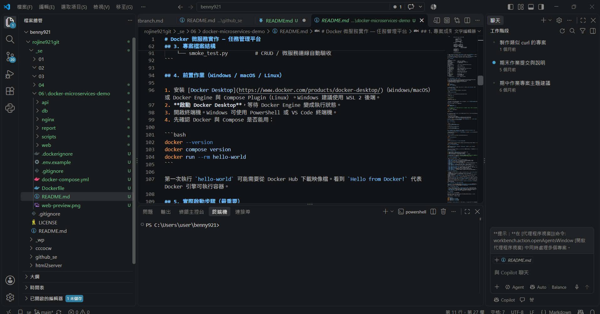
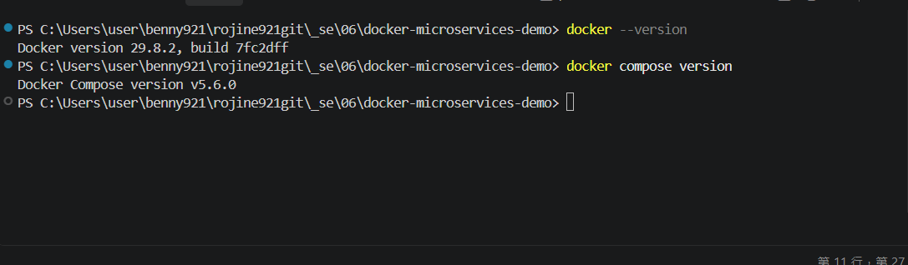
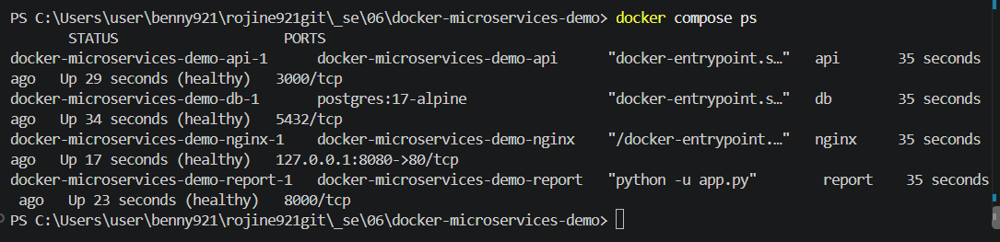
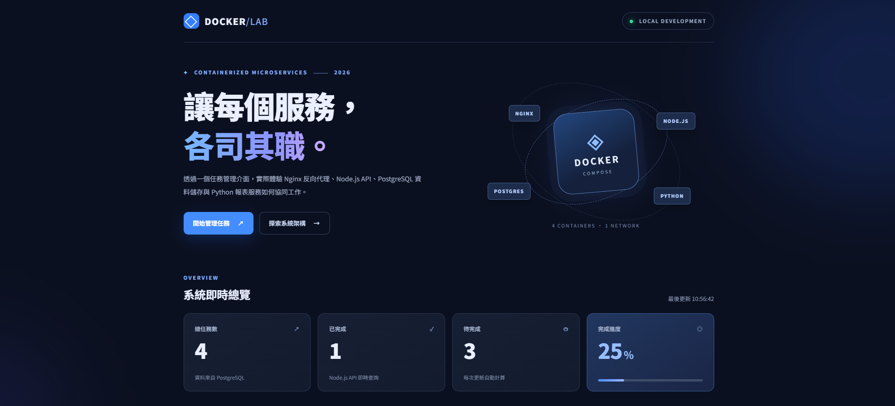
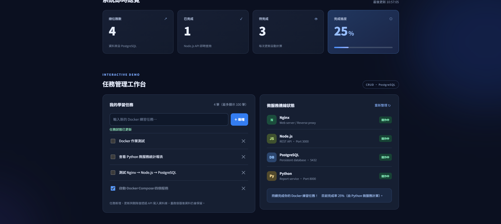
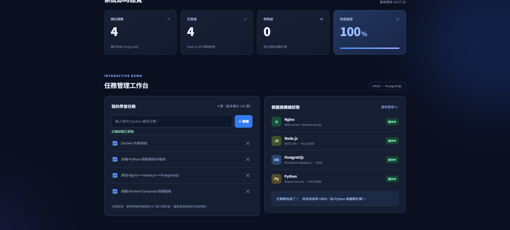

# Docker 微服務實作 — 任務管理平台

> 課堂作業：練習 Docker 指令、撰寫 Dockerfile / `docker-compose.yml`，使用 Nginx、PostgreSQL、Node.js、Python 建立能操作的 Web 系統。
>
> 本專案為**可在個人電腦執行的教學範例**，不是具有登入、權限控管、HTTPS 的正式上線產品。

## 1. 專案成果與使用的技術

瀏覽器開啟 **http://localhost:8080**，即可看到 Docker 微服務任務管理平台。

> **實際執行證據**：請見 第 6 節的六張操作截圖 或直接查看 `screenshots/` 資料夾。

- **新增任務**：填入任務名稱，按「＋ 新增」。
- **讀取任務**：在清單查看目前資料庫內容。
- **更新任務**：勾選方框切換任務的完成狀態。
- **刪除任務**：按任務右邊的 `×`。
- **統計報表**：顯示總任務數、已完成、待完成、完成率。
- **容器狀態**：頁面顯示 Node.js API、PostgreSQL、Python 報表服務是否可回應。

| 容器 / 服務 | 使用技術 | 負責工作 | 容器內通訊埠 |
| --- | --- | --- | --- |
| `nginx` | Nginx | 提供 HTML / CSS / JS 網頁、API 反向代理 | `80`（對本機開放 `8080`） |
| `api` | Node.js 22、`pg` | REST API、CRUD、存取 PostgreSQL | `3000`（僅容器網路） |
| `db` | PostgreSQL 17 | 儲存任務資料、初始化 SQL | `5432`（僅容器網路） |
| `report` | Python 3.13 | 向 Node.js API 取得統計，計算完成率 | `8000`（僅容器網路） |

這是**四個容器組成的微服務練習**：Node.js 與 Python 功能分開，使用 HTTP 互相溝通，資料庫獨立提供服務。Docker Compose 負責一次啟動整套系統。

## 2. 系統架構

```text
                  在瀏覽器開啟 http://localhost:8080
                                   │
                                   ▼
                         ┌─────────────────┐
                         │ Nginx           │
                         │ Port 80         │
                         │ 靜態網頁、反向代理 │
                         └─────────────────┘
                          │              │
                  /api/tasks 等       /api/report
                          │              │
                          ▼              ▼
                   ┌───────────┐   ┌────────────┐
                   │ Node.js   │◄──│ Python     │
                   │ API :3000 │   │ Report:8000│
                   └───────────┘   └────────────┘
                          │               Python 透過 /summary
                          │               向 Node.js 取得統計
                          ▼
                   ┌──────────────┐
                   │ PostgreSQL   │
                   │ DB :5432     │
                   └──────────────┘
                          │
                          ▼
                   postgres_data（Volume）
```

**一次新增任務的資料流程**：瀏覽器 `POST /api/tasks` → Nginx 轉送到 `api:3000/tasks` → Node.js 執行參數化 `INSERT` SQL → PostgreSQL 寫入資料 → 回傳 JSON → 網頁更新列表。

**一次讀取統計的流程**：瀏覽器 `GET /api/report` → Nginx 轉送到 `report:8000/report` → Python 向 Node.js 的 `/summary` 取得計數 → Python 計算百分比 → 網頁更新四張統計卡。

## 3. 專案檔案結構

```text
docker-microservices-demo/
├── README.md                  # 本操作紀錄 / 說明文件
├── Dockerfile                 # Nginx / Web image 建置設定
├── docker-compose.yml         # 四個服務、網路、資料卷、健康檢查
├── .env.example               # 本機環境變數範本
├── .gitignore
├── .dockerignore
├── web-preview.png            # 靜態介面示意圖（不是實測）
├── screenshots/               # Windows + Docker Desktop 真實操作截圖
│   ├── 01-vscode-project.png
│   ├── 02-docker-and-compose-version.png
│   ├── 03-compose-four-healthy.png
│   ├── 04-web-home.png
│   ├── 05-task-completion-25-percent.png
│   └── 06-task-completion-100-percent.png
├── nginx/
│   └── default.conf           # Nginx 反向代理設定
├── api/
│   ├── Dockerfile             # 建置 Node.js API image
│   ├── .dockerignore
│   ├── package.json           # Node.js 套件（pg）
│   └── server.js              # REST API / PostgreSQL CRUD
├── report/
│   ├── Dockerfile             # 建置 Python 報表 image
│   └── app.py                 # Python 標準函式庫 HTTP 微服務
├── db/
│   └── init.sql               # 初始化資料表與 3 筆測試資料
├── web/
│   ├── index.html             # Web 操作介面
│   ├── style.css              # 網頁樣式、響應式版型
│   └── app.js                 # 呼叫 API、互動按鈕
└── scripts/
    └── smoke_test.py         # CRUD / 微服務連線自動驗收
```

## 4. 前置作業（Windows / macOS / Linux）

1. 安裝 [Docker Desktop](https://www.docker.com/products/docker-desktop/)（Windows/macOS）或 Docker Engine 與 Compose Plugin（Linux）。Windows 建議使用 WSL 2 後端。
2. **啟動 Docker Desktop**，等待 Docker Engine 變成執行狀態。
3. 開啟終端機。Windows 可使用 PowerShell 或 VS Code 終端機。
4. 先確認 Docker 與 Compose 是否能用：

```bash
docker --version
docker compose version
docker run --rm hello-world
```

第一次執行 `hello-world` 可能需要從 Docker Hub 下載映像檔。看到 `Hello from Docker!` 代表 Docker 引擎可執行容器。

## 5. 實際啟動步驟（最重要）

**步驟 A：進入專案資料夾**（請依自己的解壓縮位置調整路徑）：

```bash
cd docker-microservices-demo
```

**步驟 B：建立 `.env` 環境變數檔案**。Linux、macOS、Git Bash：

```bash
cp .env.example .env
```

Windows PowerShell：

```powershell
Copy-Item .env.example .env
```

`.env.example` 已有本機教學用帳密。若使用共用電腦，請先修改 `.env` 的 `POSTGRES_PASSWORD`。**不要把自己的 `.env` 上傳到 GitHub。**

**步驟 C：檢查 Compose 設定，再建置與啟動**：

```bash
docker compose config
docker compose up -d --build
```

> `-d`：在背景執行；`--build`：先依 Dockerfile 建立 / 更新自訂映像檔。第一次下載基底 image 或安裝 `pg` 套件需要網路。

**步驟 D：確認四個服務啟動**：

```bash
docker compose ps
```

預期 `db`、`api`、`report`、`nginx` 共 **4 個服務**，經健康檢查後顯示 `healthy`。初次啟動可能需要一段時間初始化資料庫。

**步驟 E：打開 Web 介面**：

- 網址：**http://localhost:8080**
- 操作：新增「學會 docker compose」、勾選完成、刪除任務，確認統計數字會變。
- 網頁中的「微服務連線狀態」應顯示 Node.js、PostgreSQL、Python「運作中」。

若 8080 被占用，可將 `.env` 裡的 `APP_PORT=8080` 改成 `APP_PORT=8081`，再執行 `docker compose up -d --build`，改開 http://localhost:8081。

## 6. 測試、驗收與截圖

### (一) 網頁 / API 驗收

```bash
# 查看 API 是否連到資料庫
curl http://localhost:8080/api/health

# 查看全部任務
curl http://localhost:8080/api/tasks

# 查看 Python 計算的任務報表
curl http://localhost:8080/api/report
```

預期 `/api/health` 含有 `"status":"ok"` 與 `"database":"connected"`。`/api/report` 會有 `total`、`done`、`pending`、`completion_rate` 欄位。

**PowerShell 提醒**：若電腦的 `curl` 是 `Invoke-WebRequest` 別名，可用 `curl.exe`，或直接把上述三個網址貼到瀏覽器。

### (二) 執行自動測試

電腦若安裝 Python 3，於專案根目錄執行（**必須先啟動 Docker**）：

```bash
python scripts/smoke_test.py
```

或指定不同網頁埠：

```bash
python scripts/smoke_test.py --url http://localhost:8081
```

程式會依序測試：API / DB 健康檢查、Python 報表、新增、查詢、修改與刪除任務。全部通過時顯示 `[PASS]`。測試資料在最後會自動清除。

### (三) 查看 PostgreSQL 的真實內容

```bash
docker compose exec db psql -U demo_user -d docker_demo -c "SELECT id, title, completed FROM tasks ORDER BY id;"
```

當你從網頁新增、修改任務後，重新執行這行 SQL，應看到資料跟著改變。帳號和資料庫名稱如果已在 `.env` 修改，指令也要一起修改。

### (四) 實際操作截圖（2026-10-16，Windows / VS Code / Docker Desktop）

以下圖片均為**本機實際執行 Docker 系統的畫面截圖**，已儲存在專案的 `screenshots/` 資料夾。這些是操作證據，不是前端 mockup；原本的 `web-preview.png` 另屬示意圖。

**圖 1：在 VS Code 開啟完整專案**，可看見 `Dockerfile`、`docker-compose.yml`、`README.md` 以及四個服務的程式資料夾。



**圖 2：Docker 與 Compose 版本**。VS Code 的 PowerShell 成功執行 `docker --version` 及 `docker compose version`，顯示 Docker `29.8.2`、Compose `v5.6.0`。



**圖 3：四個容器的執行狀態**。執行 `docker compose ps`，可以看到 `api`、`db`、`nginx`、`report` 四個服務都顯示 `Up ... (healthy)`；Nginx 對本機開放 `127.0.0.1:8080`。



**圖 4：實際啟動的網頁首頁**。在瀏覽器開啟 `http://localhost:8080`，顯示「Docker 微服務任務管理平台」首頁、系統總覽與 Docker 架構介紹。



**圖 5：操作前的任務狀態（25%）**。任務總數 4 筆、已完成 1 筆、待完成 3 筆，右側顯示 Nginx、Node.js、PostgreSQL、Python 均運作中。



**圖 6：勾選任務完成後（100%）**。任務總數維持 4 筆，已完成由 1 筆變為 4 筆，待完成 0 筆，報表完成率更新為 100%。



**資料保留測試（文字紀錄）**：執行 `docker compose restart` 後重新整理網頁，使用者再次確認原有的 4 筆任務仍在。這證明此次容器**重新啟動**後資料仍保留；目前沒有提供重新啟動後的額外截圖，也沒有測試 `down -v`（該指令會刪除資料卷）。

**可選擇補拍的證明**：執行第 6 節（三）的 `psql` 查詢指令，將資料庫實際查詢結果截圖放在 `screenshots/`，以提供更直接的 SQL 證據；目前未將此步驟標記為完成。

## 7. 我的 Docker 指令學習與實作紀錄

| 指令 | 用途 | 此作業對應操作 / 觀察重點 |
| --- | --- | --- |
| `docker --version` | 確認安裝 Docker | 找出 Docker CLI 版本 |
| `docker run --rm hello-world` | 第一次執行容器 | 驗證 Engine 可拉取並執行 image |
| `docker images` | 列出映像檔 | 可找到 Nginx、PostgreSQL、自訂 Node/Python image |
| `docker ps` | 列出執行中容器 | 顯示目前運作容器與埠號 |
| `docker ps -a` | 包含已停止的容器 | 排查容器異常退出 |
| `docker compose config` | 驗證 Compose 設定與環境變數 | 確認服務與組態已正確展開（可能顯示密碼，不要公開） |
| `docker compose up -d --build` | 建置並啟動全部服務 | 一次建立四個容器與網路、資料卷 |
| `docker compose ps` | 查看專案服務狀態 | 確認 `healthy` 及 Nginx 綁定的埠 |
| `docker compose logs -f api` | 查看 Node.js 的日誌 | 排查 API / SQL 錯誤；按 Ctrl+C 退出日誌 |
| `docker compose logs --tail=50 nginx` | 查看 Nginx 日誌 | 排查反向代理或網頁錯誤 |
| `docker compose exec db psql ...` | 進入正在執行的 DB 容器執行 SQL | 驗證資料不是只存在前端 |
| `docker compose restart api` | 重啟單個服務 | 測試重啟後可以恢復連線 |
| `docker volume ls` | 查看持久化資料卷 | 確認 PostgreSQL 使用 named volume |
| `docker compose down` | 關閉並移除容器與專案網路 | **保留資料卷和任務資料** |
| `docker compose down -v` | 連資料卷一起刪除 | **會清除所有任務資料**，只在確定要重置時使用 |

### Docker 核心觀念（學習筆記）

- **Image（映像檔）**：由 Dockerfile 建構的唯讀應用範本；這份作業使用 `nginx`、`node`、`python` 基底 image。
- **Container（容器）**：image 執行後的實例；此系統一次跑 4 個，彼此分工。
- **Dockerfile**：定義建置單一 image 的步驟。`FROM` 選基底、`COPY` 複製程式、`RUN` 安裝相依套件、`CMD` 定義啟動程式。
- **Docker Compose**：使用 `docker-compose.yml` 管理多個容器、啟動順序、健康檢查、網路與 Volume。
- **Network**：Compose 的 `backend` 網路讓容器用服務名稱（例如 `db`、`api`）互相尋址，而非寫死 IP。
- **Volume**：`postgres_data` 儲存資料庫檔案；即使 `docker compose down` 移除容器，資料仍保留。
- **Ports**：此範例只有 Nginx 透過 `127.0.0.1:8080:80` 發布到本機；資料庫與 API 只在內部網路通訊。
- **Reverse proxy（反向代理）**：瀏覽器只呼叫 Nginx 的 `/api/...`；由 Nginx 按路徑轉送至對應服務。
- **Healthcheck**：確認服務是否能回應；`depends_on: condition: service_healthy` 讓依賴的服務等到上游健康後才啟動。

### 為什麼要寫 Dockerfile 和 docker-compose.yml？

`Dockerfile` **負責做一個容器要跑的 image**；`docker-compose.yml` **負責把多個服務組合起來執行**。本專案使用 3 份 Dockerfile（根目錄 Nginx、`api/Dockerfile`、`report/Dockerfile`）及 1 份 Compose 檔；PostgreSQL 使用官方 image，無需再寫一份 Dockerfile。

## 8. 資料庫、環境變數與資料持久化

- 初次建立資料卷時，PostgreSQL 自動執行 `db/init.sql`，建立 `tasks` 資料表及三筆示範資料。
- 使用 named volume `postgres_data`，執行 `docker compose down` 後再次 `up`，任務資料仍在。
- `db/init.sql` **只在資料目錄第一次初始化時執行**。修改 SQL 檔，不會直接重設已存在的資料庫。
- `docker compose down -v` 會刪除持久資料，重新 `up` 才會重新初始化。這是**破壞性操作**。
- `.env` 存放開發用資料庫參數；`.env.example` 可提交，真正 `.env` 應保密。

## 9. 常見錯誤排除

**Q1：輸入 `docker` 顯示找不到指令？**

先安裝 Docker Desktop，再確認 Docker Desktop 已啟動，重新打開終端機。Windows 使用 Docker Desktop 時，檢查 WSL 2 是否安裝並啟用。

**Q2：網站無法連線 / 頁面沒載入資料？**

```bash
docker compose ps
docker compose logs --tail=100 db
docker compose logs --tail=100 api
docker compose logs --tail=100 report
docker compose logs --tail=100 nginx
```

先看有沒有容器 `Exited`、`unhealthy`，再讀取相對應日誌。第一輪 image 下載與資料庫初始化需要時間。

**Q3：8080 埠被占用？**

把 `.env` 中的 `APP_PORT` 改為 `8081`，重新執行 `docker compose up -d --build`。也可先關閉占用該埠的程式。

**Q4：PostgreSQL 密碼改了卻登入失敗？**

建立資料庫後，變更 `.env` 的 `POSTGRES_PASSWORD` 不會自動修改既有資料庫使用者的密碼。保留資料時需在資料庫中自行修改；如果只是練習、確定資料不需要保留，才使用 `docker compose down -v` 後重新建立。

**Q5：網頁更改 CSS / JS 後看不到更新？**

Nginx 靜態檔案在 image 建置時透過 Dockerfile 的 `COPY` 放入，需要重新執行 `docker compose up -d --build nginx`（或完整 `docker compose up -d --build`），瀏覽器可再按 Ctrl+F5 強制重新整理。

**Q6：為什麼不用 `docker-compose`（有連字號）？**

現代 Docker Desktop 使用 Compose V2，官方慣用指令為 **`docker compose`**（中間是空格）；老師指定的檔名 `docker-compose.yml` 一樣可以使用。

## 10. 練習結果及驗證紀錄

**已完成的原始碼 / 設定檔**

- [x] 三個 Dockerfile（根目錄 Nginx / Node.js / Python）
- [x] `docker-compose.yml`：4 個服務、健康檢查、網路、資料卷
- [x] Nginx Web Server / Reverse Proxy
- [x] PostgreSQL 初始化 SQL 與持久化設計
- [x] Node.js 任務 CRUD API、Python 統計報表微服務
- [x] HTML / CSS / JavaScript 前端
- [x] 可重複執行的自動測試程式 `scripts/smoke_test.py`

**測試範圍說明**：原始專案的撰寫環境沒有 Docker，當時只完成語法與局部功能檢查；但在 **2026-10-16 已於 Windows 電腦使用 Docker Desktop 與 VS Code 真正啟動四個容器並測試網頁**。第 6 節收錄本機實測圖片。以下分別標明「已驗證」和「尚未執行」，避免混淆。

| 測試項目 | 方法 / 證據 | 驗證結果 |
| --- | --- | --- |
| JavaScript 語法 | 製作端 `node --check api/server.js`、`node --check web/app.js` | 已通過 |
| Python 語法 | 製作端 `python -m py_compile report/app.py scripts/smoke_test.py` | 已通過 |
| YAML 格式 / 服務定義 | 製作端 Python YAML parser | 已通過 |
| Nginx 設定 | 製作端 `nginx -t`（將 Docker 服務名稱暫時替換為 localhost） | 已通過局部檢查 |
| Python 報表功能 | 製作端使用模擬的 Node.js 統計回應呼叫 `/report` | 已通過局部檢查 |
| Docker / Compose 指令 | Windows 終端機查詢版本，圖 2 | **已實測** |
| 四個 Docker 容器啟動 | `docker compose up -d --build`、`docker compose ps`，圖 3 顯示全 healthy | **已實測** |
| Nginx 網頁入口 | 瀏覽器開啟 `http://localhost:8080`，圖 4 | **已實測** |
| 任務更新與跨服務統計 | 完成率 25% → 100%，圖 5 與圖 6 | **已實測** |
| 重啟後任務資料仍保留 | `docker compose restart` 並重新整理頁面，使用者確認 4 筆任務仍在 | **已實測（文字紀錄）** |
| 直接 SQL 查詢資料庫 | 第 6 節（三）的 `psql` 指令 | **尚未提供執行證據** |
| Python 自動化端到端測試 | `python scripts/smoke_test.py` | **尚未執行 / 尚未提供證據** |

### 實際操作與問題排除紀錄

1. **安裝 Docker Desktop**：在 Windows 安裝 Docker Desktop，開啟後確認引擎顯示 `Engine running`。
2. **第一次指令失敗**：原本已開啟的 VS Code PowerShell 輸入 `docker --version`，系統顯示找不到 `docker` 指令。
3. **排除方式**：關閉並重新啟動 VS Code，新終端機便能找到 Docker 指令；實際版本為 Docker `29.8.2` / Compose `v5.6.0`（圖 2）。
4. **啟動專案**：進入 `docker-microservices-demo` 資料夾，建立 `.env`，執行 `docker compose up -d --build`。
5. **確認容器**：執行 `docker compose ps`，四個服務皆顯示 `healthy`（圖 3）。
6. **測試網頁**：開啟 `http://localhost:8080`，確認頁面顯示、任務勾選與完成率由 25% 增加到 100%（圖 4～6）。
7. **驗證重啟後資料仍在**：執行 `docker compose restart`，重新整理網頁，原有 4 筆任務沒有消失（使用者確認）。

> 註：上述為此次實際觀察的紀錄。`docker compose restart` 只能證明重啟後資料仍保留；若要進一步驗證容器移除再重建的持久性，可使用 `docker compose down` 後 `docker compose up -d`，**但不可使用 `down -v`**，因為它會刪除資料卷。

### 本次學習總結

此次練習把網頁、後端 API、統計功能與資料庫拆成不同的服務。Nginx 是唯一對外入口；Node.js 處理主要功能與 SQL；Python 專門計算報表；PostgreSQL 將資料存進 Volume。透過 Compose，原本需要個別啟動的四套程式可以由一行指令組合啟動。驗收時不只看得到網頁，也能使用 `docker compose ps`、API 呼叫與 SQL 查詢，檢查每個容器是否真的有發揮作用。

## 11. 參考資料

- [Docker 官方：Get started](https://docs.docker.com/get-started/)
- [Docker 官方：Compose Quickstart](https://docs.docker.com/compose/gettingstarted/)
- [Docker 官方：Compose depends_on 與健康檢查](https://docs.docker.com/compose/how-tos/startup-order/)
- [Docker 官方：Compose 檔案命名](https://docs.docker.com/compose/intro/compose-application-model/)
- [PostgreSQL 官方 Docker Image：初始化腳本](https://hub.docker.com/_/postgres)
