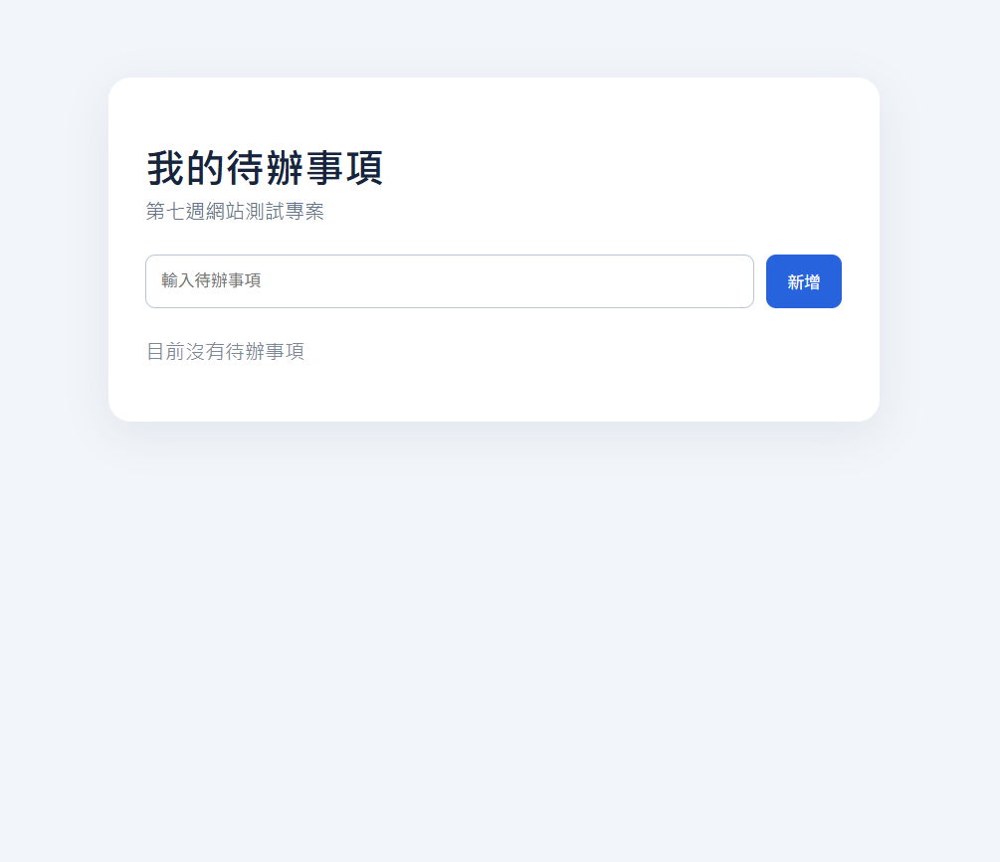
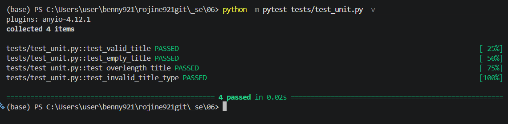
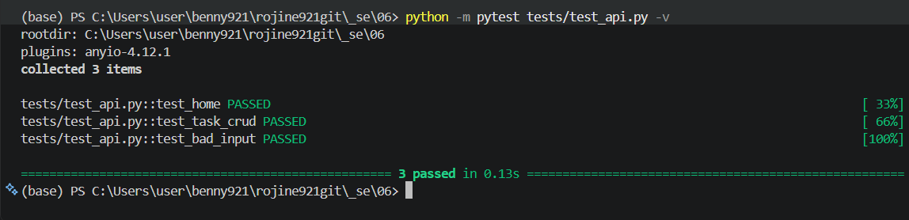
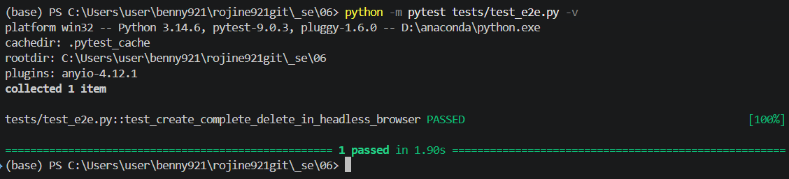

# 第七週作業：待辦事項管理網站與三種測試

本專案為獨立開發的待辦事項管理網站，**不使用大學校務系統**。使用 Python Flask 提供網站及 Web API，以 SQLite 儲存待辦事項，並透過 pytest 和 Playwright 進行測試。

## 一、網站功能

- 新增待辦事項
- 顯示待辦事項清單
- 勾選完成／未完成
- 刪除待辦事項
- 使用 SQLite 保存資料

### 網站畫面



## 二、開發環境與技術

- Windows 11、VS Code、Anaconda / Python 3.14.6（本次測試環境）
- Flask（伺服器與 Web API）、SQLite（資料庫）
- HTML / CSS / JavaScript（前端）
- pytest（單元測試、系統測試）
- Playwright + Chromium（E2E 無頭瀏覽器）

## 三、安裝與啟動

使用 VS Code 開啟 `_se/06` 資料夾，或先在終端機移動到專案目錄：

```powershell
cd "C:\Users\user\benny921\rojine921git\_se\06"
```

確認已啟用可用的 Anaconda Python 環境，再安裝套件及 Playwright 瀏覽器：

```powershell
python -m pip install -r requirements.txt
python -m playwright install chromium
```

啟動網站：

```powershell
python app.py
```

用瀏覽器開啟 <http://127.0.0.1:5000>；結束網站時在終端機按 `Ctrl + C`。

## 四、測試方式與實際結果

### 1. 單元測試（Unit Test）

測試伺服器端 `validate_task()` 函式，涵蓋合法標題、空白標題、過長標題、錯誤資料型別。

```powershell
python -m pytest tests/test_unit.py -v
```

**實際結果：4 passed in 0.02s**



### 2. 系統測試（Web API / System Test）

使用 Flask test client 發送 HTTP 請求，測試網站首頁、待辦事項 API 的新增／查詢／修改／刪除（CRUD）及錯誤輸入處理。

```powershell
python -m pytest tests/test_api.py -v
```

**實際結果：3 passed in 0.13s**



### 3. E2E 測試（Playwright Headless）

使用 Playwright 啟動 **headless Chromium**，模擬真實使用者打開網站、建立待辦事項、勾選完成，再刪除該事項，最後確認清單為空。

```powershell
python -m pytest tests/test_e2e.py -v
```

**實際結果：1 passed in 1.90s**



### 測試總結

| 類型 | 測試檔案 | 測試項目 | 執行結果 |
|---|---|---:|---|
| 單元測試 | `tests/test_unit.py` | 4 | 4 passed |
| 系統測試（Web API） | `tests/test_api.py` | 3 | 3 passed |
| E2E 無頭瀏覽器 | `tests/test_e2e.py` | 1 | 1 passed |
| **合計** | | **8** | **8 passed** |

以上結果根據 2026-10-23 的本機執行截圖記錄；下載至其他電腦後請自行重新執行測試確認。

也可以一次執行所有測試：

```powershell
python -m pytest tests -v
```

E2E 測試會自動啟動測試伺服器，不需要事先執行 `python app.py`。測試使用獨立的臨時 SQLite 資料庫，避免修改日常使用的資料。

## 五、Web API 設計

| HTTP 方法 | API 路徑 | 用途 |
|---|---|---|
| `GET` | `/api/tasks` | 取得清單 |
| `POST` | `/api/tasks` | 新增待辦事項 |
| `PATCH` | `/api/tasks/<id>` | 修改完成狀態 |
| `DELETE` | `/api/tasks/<id>` | 刪除待辦事項 |

POST 資料範例：

```json
{"title": "完成第七週作業"}
```

## 六、專案檔案結構

```text
06/
├── app.py
├── requirements.txt
├── README.md
├── templates/
│   └── index.html
├── static/
│   ├── app.js
│   └── style.css
├── tests/
│   ├── conftest.py
│   ├── test_unit.py
│   ├── test_api.py
│   └── test_e2e.py
└── screenshots/
    ├── 01_website.png
    ├── 02_unit_tests.png
    ├── 03_api_tests.png
    └── 04_e2e_tests.png
```

## 七、注意事項

- 專案為課堂示範網站，使用 Flask 開發伺服器，並非正式對外服務。
- `tasks.db`、測試快取與虛擬環境等自動產生檔案不建議提交 GitHub。
- 請保留 `screenshots` 資料夾與 README 的相對路徑，才能在 GitHub 正常顯示圖片。
