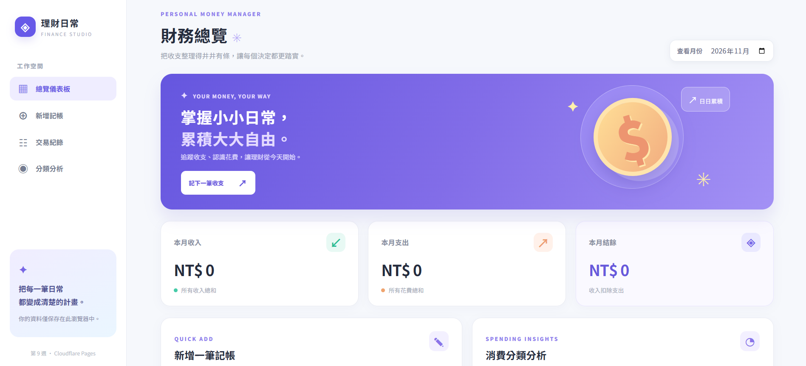

# 第 11 週期末作品規劃｜理財日常：智慧記帳與消費分析網站

## AI 工具使用說明

使用 OpenAI ChatGPT 協助既有作品開發與文件整理，這份 README 也使用 Codex 協助撰寫。

現代軟體工程｜翁沂慶（111410505）

## 作品簡介

「理財日常」是一個個人記帳網站。使用者可以記錄每天的收入與支出，按月份查看結餘、比較各類支出占比，並匯出交易明細。期末作品將延續第 9 週的網站和第 10 週的 JavaScript 工具套件，讓網站和套件共用統計與資料處理邏輯。

## 目前成果

- **記帳網站**支援新增及刪除交易、依月份瀏覽、依項目或分類搜尋，以及依收支類型篩選。總覽顯示所選月份的收入、支出、結餘與消費分類圖表，也可匯出該月的 CSV 明細。[網站原始碼](../07/) · [線上展示](https://expense-tracker-07.pages.dev)
- **記帳工具套件**提供 `totals()`、`categorySummary()`、`filterByMonth()` 和 `toCSV()`，分別處理收支統計、分類加總、月份篩選與 CSV 匯出。套件已有涵蓋這些功能及無效輸入的單元測試。[套件原始碼](../10/) · [npm 套件頁](https://www.npmjs.com/package/expense-tracker-utils-rojine921)
- **技術與資料儲存**採用 HTML、CSS、JavaScript 和 Cloudflare Pages。網站將資料存於瀏覽器的 `localStorage`，資料會留在目前使用的瀏覽器，清除網站資料時也會一併移除。



## 本機預覽與測試

在儲存庫根目錄執行下列指令啟動本機預覽。需要 Python 3，啟動後在瀏覽器開啟 `http://localhost:8000`。

```bash
python -m http.server 8000 --directory 07
```

新增同月的 30,000 元收入與 200 元餐飲支出，確認總覽結餘為 29,800 元、餐飲支出為 200 元，並確認匯出的 CSV 包含兩筆交易。套件測試需要 Node.js 18 以上，可從儲存庫根目錄執行下列指令。

```bash
npm --prefix 10 test
```

## 期末待完成事項

- [ ] 將套件的月份篩選、收支統計、分類加總及 CSV 匯出整合到網站，保留既有記帳資料和 CSV 的項目欄位。
- [ ] 驗證新增及刪除交易後的統計更新、切換月份、重新整理後的資料保留，以及 CSV 匯出。
- [ ] 更新 Cloudflare Pages 部署，整理操作截圖、測試結果與期末展示步驟。

## 期末預計繳交

- 記帳網站原始碼、公開展示網址與操作截圖。
- JavaScript 工具套件原始碼、npm 套件連結與測試結果。
- 說明作品功能、本機執行方式與展示步驟的 README。


